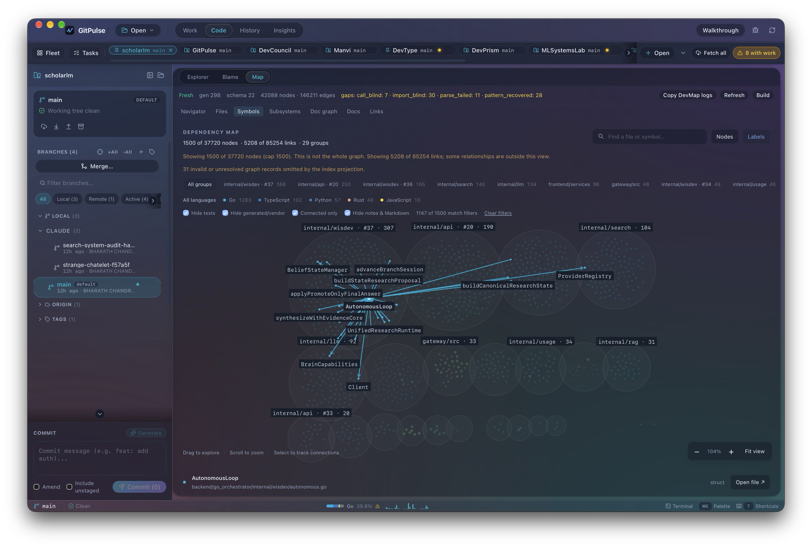

<p align="center">
  
</p>

# DevMap, by DevCouncil

**Tell your coding agent what an edit will break before it makes it.**

DevMap is a local, symbol-level code graph for Claude Code, Cursor, Codex and
other agents. It answers "who calls this?", "what does this change reach?",
"which tests should I run?" and "what is dead?" in under a second, from the
command line or over MCP. No model key, no account, no cloud: the index lives
in a `.devmap/` directory in your repository (add it to `.gitignore`).

[](https://devcouncil.vbcr.dev/)
[](https://github.com/bharathvbcr/DevCouncil/actions/workflows/ci.yml)
[](https://github.com/bharathvbcr/DevCouncil/releases)
[](LICENSE)



## Install

macOS and Linux:

```bash
curl --proto '=https' --tlsv1.2 -LsSf https://github.com/bharathvbcr/DevCouncil/releases/latest/download/devmap-cli-installer.sh | sh
```

Homebrew:

```bash
brew install bharathvbcr/tap/devmap
```

Windows (PowerShell):

```powershell
powershell -ExecutionPolicy Bypass -c "irm https://github.com/bharathvbcr/DevCouncil/releases/latest/download/devmap-cli-installer.ps1 | iex"
```

The shell and PowerShell installers put one self-contained `devmap` binary in
`~/.local/bin`; Homebrew puts it in its own prefix. You
can also download the archive for your platform (macOS arm64 and x86_64,
Linux x86_64, Windows x64) from
[Releases](https://github.com/bharathvbcr/DevCouncil/releases) and check it
against its `.sha256`. To build from source instead, see the
[quickstart](docs/quickstart.md).

## Sixty seconds with DevMap

```bash
cd your-project
devmap build --manifest          # index the repository
devmap search config             # find real symbol names to ask about
devmap explore parse_config      # definition, source, callers, callees
devmap impact parse_config       # everything that reaches it, transitively
devmap affected parse_config     # test files reached through its callers
devmap dead                      # dead-code candidates, each with a confidence
```

Replace `parse_config` with a name `search` printed. Then give your agent the
same answers:

```bash
devmap integrate claude --dry-run   # list the repo files and global MCP entries it would write
devmap integrate claude             # or cursor, codex, antigravity, opencode, warp
```

## What your agent can ask

| Question | Command | MCP tool |
|---|---|---|
| Where is this defined, and what surrounds it? | `devmap explore NAME` | `devmap_explore` |
| What breaks if I change it? | `devmap impact NAME` | `devmap_impact` |
| What would this unsaved edit break? | `devmap preview --file F --content -` | `devmap_preview` |
| Which tests should I run? | `devmap affected NAME` | `devmap_affected_tests` |
| What did my last commits reach? | `devmap blast --since REV` | `devmap_blast` |
| Which commit could have caused this bug? | `devmap suspects SYMPTOM --since REV` | `devmap_suspects` |
| Where is the code for a behaviour I can't name? | `devmap ask "QUESTION"` | `devmap_ask_evidence` |
| What can I safely delete? | `devmap dead` | `devmap_dead_symbols` |

Every answer says what it left out. `truncated`, `walk_incomplete` and
per-row `confidence` separate "nothing calls this" from "the index could not
tell". Treat dead-code rows as candidates to check, not a delete list.

## Why DevMap

- **It answers before the edit.** `preview` diffs an unsaved buffer against the
  index and names the calls a removal would break. `affected` picks the tests
  to run.
- **It is fast.** In our benchmark across four repositories (595 to 4,335
  files), DevMap 0.2.2 had the fastest cold index and unchanged refresh of the five
  standalone tools timed, and the lowest median on every symbol query.
  CodeGraph re-indexed a single edited file faster on every corpus. Method,
  raw output and every loss:
  [DevMap vs GitNexus, CodeGraph, Graphify, Gortex and codebase-memory-mcp](docs/devmap/comparison.md).
- **It stays local.** One native binary and a SQLite store per repository. No
  account, no API key, no model in the loop.

## The rest of DevCouncil

DevMap is the engine most people want. DevCouncil is the full set of modules it
belongs to. Each one is a separate binary you can install, run and update on
its own:

| Module | What it does | Install |
|---|---|---|
| `devmap` | Code graph: callers, impact, affected tests, dead code, MCP server | Prebuilt (above) |
| `devcouncil` (`dev`) | Go host: task MCP server, task leases, agent integration, specs and DAG workflows, `verify` orchestration, unified `search` | From source |
| `dcstore` | SQLite task and workbench store: tasks, leases, evidence records, gaps | From source |
| `dcverify` | Deterministic checks on an agent's diff: planned scope, stubs, test rigor, changed-line coverage | From source |
| `dcgrep` | Ignore-aware text search with optional trigram index and BM25 ranking | From source |
| `dcredact` | Credential redaction over a JSON-on-stdio contract, failing closed | From source |

`bash scripts/install.sh` from a clone builds and installs the whole set; the
[quickstart](docs/quickstart.md) covers presets and Windows. How the modules fit
together, and which apps (Manvi, GitPulse) consume which, is in the
[architecture](docs/architecture.md). The task loop that ties the host, store and
verifier together is in the [task workflow](docs/workflow.md) and the
[MCP loop](docs/hero-loop.md). [GitPulse](https://gitpulse.vbcr.dev/),
a desktop command centre for parallel coding agents, uses DevMap for its
collision radar.

## Documentation

| Topic | Guide |
|---|---|
| Install, build from source, first query | [Quickstart](docs/quickstart.md) |
| Editor and agent setup | [Integration](docs/coding-cli-integration.md) |
| Symbols, impact and evidence limits | [Code graph](docs/code-graph.md) |
| Commands and flags | [CLI reference](docs/cli-reference.md) |
| Components and state ownership | [Architecture](docs/architecture.md) |
| Task workflow and verification | [Workflow](docs/workflow.md) and [MCP loop](docs/hero-loop.md) |
| Security boundaries | [Repository input and verification boundaries](docs/SECURITY_BOUNDARIES.md) |
| Everything else | [Documentation index](docs/README.md) |

## License

[Apache 2.0](LICENSE). DevMap parses source with
[tree-sitter](https://github.com/tree-sitter/tree-sitter) (MIT).
