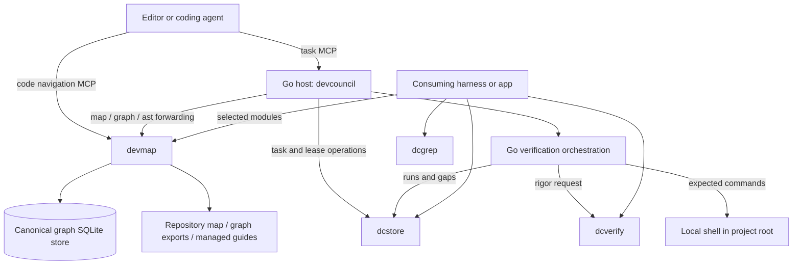
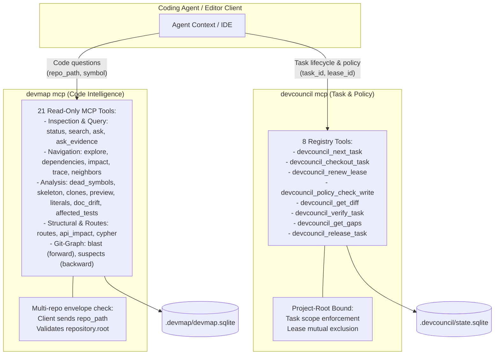
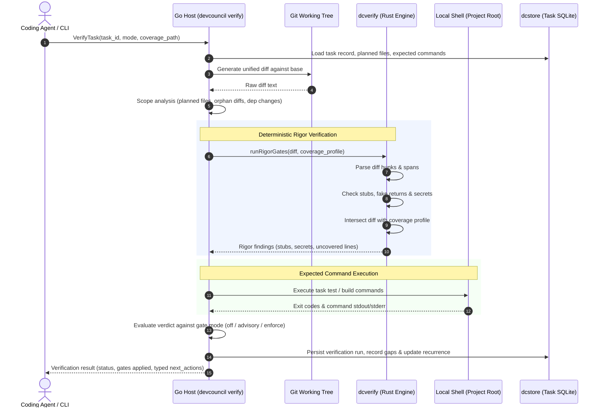
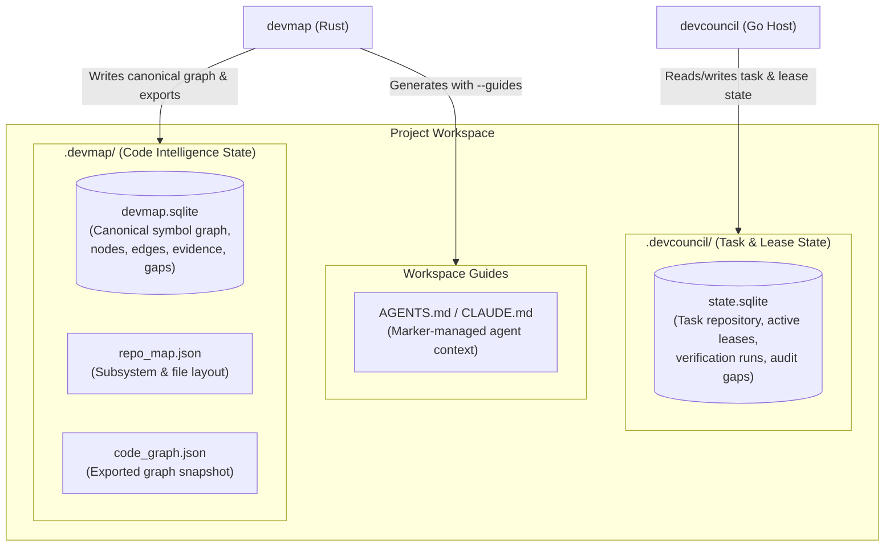

# Architecture

DevCouncil supplies native components for AI-assisted development. The Go host
connects task tooling; Rust owns code intelligence, state, search and rigor
checks. A consumer can use a single binary or selected library crates.
[Documentation index](README.md)

## Components and ownership

| Component | Source owner | Responsibility |
|---|---|---|
| `devc` / `devcouncil` / `dev` | `backend/go_orchestrator/cmd/devcouncil/` | Host CLI, task MCP, 7-layer specification lifecycle (`spec`), resumable DAG workflow engine (`workflow`), unified search router (`search`), load-aware FIFO job scheduler (`devcouncil/scheduler`), secondary judge model verification (`devcouncil/verify`), integration, skills, verification orchestration and DevMap forwarding |
| `devc-map` / `dc-map` / `devmap` | `rust/devmap-cli/` and `rust/devmap-*` | Unified code intelligence and graph engine: Extraction, 11-tier symbol resolution ladder (`rung`), Blake3 content-addressed AST storage (`cas`), per-worktree delta overlays (`overlay`), zero-copy `mmap` Compressed Sparse Row (CSR) graph storage (`devmap-store::csr`: `CsrGraphReader`, `CsrGraphWriter`, `AtomicGraphHandle`, `FastBitSet`, `sqlite_v30`), analysis, queries, watching and navigation MCP |
| `devc-store` / `dc-store` / `dcstore` | `rust/dc-store/` | SQLite task and workbench state, ratified constitution gates (`constitution_gates`), active leases (`ux_task_leases_active`), verification records and gaps |
| `devc-verify` / `dc-verify` / `dcverify` | `rust/dc-verify/` | Structured diff analysis, scope classification, stub/secret checks and diff–coverage intersection |
| `devc-grep` / `dc-grep` / `dcgrep` | `rust/dc-grep/` | Ignore-aware text search with optional trigram indexing and BM25 rank scoring (decoupled ceilings, 64 MiB lexical budget, completeness contract) |
| `dc-proc` | `rust/dc-proc/` and `backend/go_orchestrator/proc/` | Subprocess isolation invariants: 5 s default deadline, `/dev/null` stdin, process-group `SIGTERM`/`SIGKILL` escalation and daemon reaping |

The diagram describes implemented interfaces, not a claim that every consumer
uses every edge.

### Host integration and skill installation: one owner

**Decision (2026-10-08, owner): `devmap integrate`, `devmap skills install`,
and `devmap agents install` own host integration, skill installation, and
Antigravity agent installation; the Go host delegates.**

- **Host list and per-host documents.** The Rust `integrate::Host` enum is the
  only host list, and `Host::project_document` in
  [`rust/devmap-cli/src/integrate.rs`](../rust/devmap-cli/src/integrate.rs)
  is the only table of where each host keeps its project MCP servers and how
  that document is shaped (JSON container, OpenCode's argv entries, Codex's
  TOML). `devcouncil integrate <host>` sends its own `devcouncil` server to
  `devmap integrate <host> --servers-stdin` as JSON
  (`{"servers": [{name, command, args, env, cwd}]}`), and DevMap writes it
  through that table beside its own entry. Codex's project
  `.codex/config.toml` is merged without rewriting any byte outside the
  `[mcp_servers.devcouncil]` table, or refused.
- **Skill receipt.** `.devcouncil-skills.json` and its lock have one writer,
  [`rust/devmap-cli/src/skills.rs`](../rust/devmap-cli/src/skills.rs).
  `devcouncil skills scaffold` loads its embedded domain-skill library and sends
  it to `devmap skills install --library-stdin`; Go no longer contains an
  installer. The receipt bytes are pinned by `the_receipt_format_is_pinned`.
- **Agent receipt.** `.devcouncil-agents.json` has one writer,
  [`rust/devmap-cli/src/agent_install.rs`](../rust/devmap-cli/src/agent_install.rs).
  `devcouncil integrate antigravity` loads the embedded library under
  `backend/go_orchestrator/devcouncil/agents/library/` and sends it to
  `devmap agents install --agents-stdin` before `devmap integrate
  --servers-stdin`. The library is four agents plus `.agents/rules/devcouncil.md`.
  Other hosts do not spawn that command. A bare `devmap integrate antigravity`
  stays MCP and DevMap skills; it does not install the task-loop agents.
  DevMap remains the only writer of `.agents/`. `--remove` does not delete
  these files; the remove note names the receipt.
- **What stays in Go.** DevCouncil's own facts: which host names it retired and
  why, what its server runs, the Cursor rule it owns outright —
  `.cursor/rules/devcouncil.mdc`, replaced only when the copy on disk is one
  DevCouncil wrote — and the Antigravity library it embeds but does not write
  into `.agents/` itself.
- **Consequences.** `devcouncil integrate` and `devcouncil skills scaffold`
  need a `devmap` (`--devmap-bin`, `DEVMAP_BIN`, or `PATH` outside the
  repository) and refuse without one rather than reporting a partial install.
  `devcouncil integrate --check` now asks DevMap and reports per-file drift.

Before this, both languages carried a host list, a per-host document table and
an installer for the same receipt, kept in step by Go tests that parsed the
Rust source. The decision removes the second copies instead of pinning them. Manvi owns its agent loop and provider orchestration. GitPulse
composes Manvi with selected DevCouncil components; those consumers have their
own versions and qualification requirements.

## Two MCP servers

`devmap mcp` serves code navigation. Its repository-aware envelopes let one
server serve multiple workspaces: clients send `repo_path` and verify the
returned `repository.root` before using the answer.

`devcouncil mcp` serves eight task/policy tools from
[`Registry.Specs`](../backend/go_orchestrator/devcouncil/registry.go): diff,
checkout, renew lease, release, next task, verify task, get gaps and check write
policy. It binds to the project root resolved by the Go host. It is not an
arbitrary shell/file-edit server. Ordinary editor writes are not intercepted
by the retired DevCouncil lifecycle hooks.

## Code graph pipeline

1. `devmap-extract` discovers files and extracts definitions, imports, calls and
   language-specific evidence (extraction schema 98). Handles Java records, compact
   constructors, enum constants, Kotlin expression-recovery, Svelte template text
   `&`/`>` repair, and CommonJS exports. Parsing and discovery gaps remain visible.
2. `devmap-resolve` resolves symbols and relationships, preserving ambiguity and
   unresolved sites rather than upgrading a name match into certainty. Supports
   Java record constructor collapse, implicit `java.lang.*` resolution, TypeScript
   barrel re-export traversal and unique interface factory return types, Rust
   same-file typed receivers and builder-chain propagation, Go build-constraint
   variant sets, and literal constant call protection. When ambiguity limits are
   reached, candidate lists degrade gracefully (marking exported maps partial)
   rather than aborting the build.
3. `devmap-analyze` computes graph analysis, lexical scoping (`scoping.rs`), normalized defect rates across the 9-class unresolved taxonomy (`resolution_rate.rs`), reachability, and liveness candidates.
4. `devmap-store` owns SQLite persistence (schema 29, reader floor 29) with zstd
   level-1 compressed extraction documents (`extraction_json`, `entry_wiring_json`,
   `extraction_cache`, and `symbol_details` payloads), multi-row batched FTS
   inserts (`FTS_50_SQL`; ledger rows stay one per execute, which measured faster
   at 605k rows), keyed semi-join ledger reads,
   payload validity ranges, payload-digest identity, pre-write search index
   integrity checks, and zero-copy `mmap` Compressed Sparse Row (CSR) storage
   (`devmap-store::csr`: `CsrGraphReader`, `CsrGraphWriter`, `AtomicGraphHandle`,
   `FastBitSet`, and `sqlite_v30` pragmas) for sub-100 ns hop traversal;
   `devmap-query` reads and composes results with the 11-tier symbol resolution
   ladder (`rung.rs`), Blake3 content-addressed AST storage (`cas.rs`), ephemeral
   per-worktree delta overlays with roaring bitmaps and tombstones (`overlay.rs`),
   bounded unresolved-namesake site lists (`sites_omitted`), and file-hit prefix reads.
5. `devmap-serve` watches and updates state; `devmap-cli` exposes CLI/MCP (21 tools) and
   integration surfaces.

Supported parsing is not complete semantic coverage. Read
[code graph interpretation](code-graph.md) before making completeness claims.

## Verification pipeline

The CLI and host MCP converge on
[`VerifyTask` / `Run`](../backend/go_orchestrator/devcouncil/verify/orchestrate.go).
The Go layer collects task and diff context, checks no-work/planned-file/orphan/
dependency conditions, and executes expected commands. It invokes `dcverify`
through [`runRigorGates`](../backend/go_orchestrator/devcouncil/verify/rigor.go)
for stub, secret and optional coverage checks.

Verification rigor encompasses:
- **Comprehensive scan coverage:** Scans untracked and recreated files, submodule
  commit-range bytes when pointers move (`proc/gitsubmodules.go`), binary-marked source,
  and streamed index entries.
- **Stub AST scanner:** Detects opaque stubs, stub-scanned binary-marked source, and
  lexer comments using whole-name path matching.
- **Secret leak prevention:** Verification error output suppresses raw diff line echoes,
  and panic hooks omit backtrace payloads, printing only file and line.
- **Bounded execution:** A single unified walk deadline bounds verification walks, with
  hard input length limits (`bounded.rs`).
- **Atomic file safety:** Rooted file reads via `safefile.OpenNoFollow` retry (up to 16
  attempts) when regular files are atomically replaced in race windows, while refusing
  symlinks and FIFOs immediately.
- **Prompt-input write protection:** Direct file writes, link creation, or git operations
  targeting prompt instruction files (`AGENTS.md`, `CLAUDE.md`, `GEMINI.md`, `mcp.json`, `.mcp.json`),
  skill roots (`.claude/`, `.cursor/`, `.agents/`), and plugin manifests are refused by the policy
  engine at any path depth across all postures (including `yolo`).

Go scope findings retain their existing owner; the rigor adapter does not
report a second independent scope verdict. Result metadata names applied gates
and skipped reasons. CLI `--coverage PATH` supplies a profile; the host MCP
verify tool does not expose that field. Missing `dcverify` is reported as a
skip; a configured verifier that fails produces an unavailable-check gap.

The gate mode governs the verdict. Default `off` reports verification skipped;
`advisory` and `enforce` have different blocking policies. A success-shaped
response or process exit alone does not establish that all checks ran.
Expected commands run in a local shell. The sandbox selector does not implement
Docker or Nix isolation. See the [task loop contract](hero-loop.md).

## State and artifacts

| Artifact | Location / resolution |
|---|---|
| Code graph database | `db_path` from `devmap paths --json`; canonical query source |
| Repository map | `repo_map` from `paths`; file/subsystem navigation |
| Graph export | `code_graph` from `paths`; may be capped |
| Agent guides | Project `AGENTS.md` / `CLAUDE.md`, written when requested and managed |
| Task state | `.devcouncil/state.sqlite`, opened by the Go host |

[`devmap-extract/src/paths.rs`](../rust/devmap-extract/src/paths.rs) owns state
resolution: configured state home, then existing `.devmap/`, then existing
`.devcouncil/`, otherwise new `.devmap/`. An explicit `--db` selects a database.
Do not confuse the task store with the graph store, or copy generated state
between worktrees.

## Build and compatibility

Use [source installers](quickstart.md) and the repository toolchain manifests.
The npm package is a launcher, separately versioned from native components.
Changing one component need not require installing all others, but wire
contracts and store schemas still need compatible readers and writers.
[Project status](project-status.md) separates current interfaces, implementation
limits and historical material.
