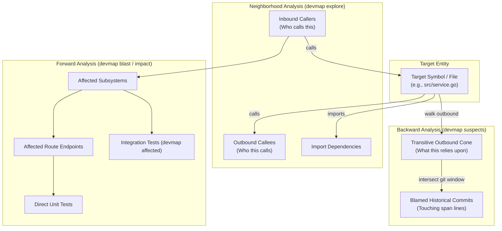
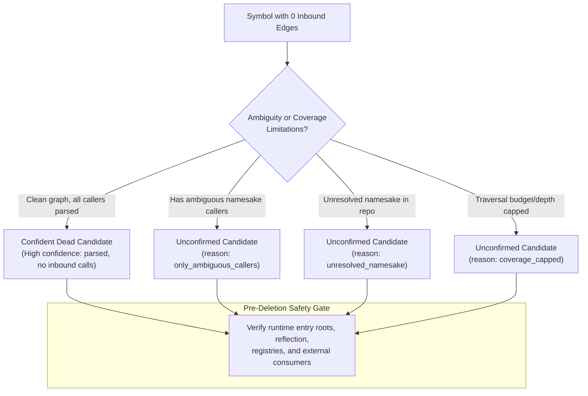

# Code graph and repository navigation

DevMap builds a local graph from source without a model call. Use it to locate
symbols, inspect relationships and narrow an investigation. Static graph
results remain evidence with limits, not runtime proof.
[Documentation index](README.md)

## Build and locate state

```bash
devmap build --manifest --guides
devmap paths --json
devmap status --json
```

`build` indexes source; `--manifest` exports map/graph artifacts; `--guides`
requests marker-managed agent guides. Without `--guides`, the manifest build
is not a guide installer. If newly created guides make the initial status
stale, run `devmap build --manifest` once more to index that inventory change.
`dev map` is Go-host forwarding to
`devmap build --manifest`.

Use `paths` rather than hard-coded state paths. New repositories use `.devmap`;
existing `.devcouncil` state remains supported, and `.devmap` wins when both
exist. Explicit configuration may override the default. The canonical SQLite
store is separate from `.devcouncil/state.sqlite`, which holds task state.
Build each worktree independently.

## Choose the question

Replace example names and paths with actual repository symbols:

| Question | Command |
|---|---|
| Find a symbol | `devmap search MyFunction --json` |
| Read its neighborhood | `devmap explore MyFunction --json` |
| Inspect change impact | `devmap impact src/service.go --json` |
| Trace a relationship | `devmap trace EntryPoint TargetFunction --json` |
| Find dead-code candidates | `devmap dead --json` |
| Find candidate tests | `devmap affected src/service.go --json` |
| Forward change impact | `devmap blast --since HEAD~1 --json` |
| Backward root-cause commits | `devmap suspects MyFunction --since v0.2.0 --json` |
| Preview unsaved edit impact | `devmap preview --file src/service.go --json` |
| Find duplicate symbol bodies | `devmap clones --json` |
| Keep the index warm | `devmap serve` |
| Inspect installed identity | `devmap --version` |



`devmap COMMAND --help` is the installed binary's flag authority. There is no
`devmap query` command and no `build --watch`; use `serve` for watching.
The daemon updates the same store. No Python build engine or Python fallback
is required.

## Interpret evidence before using it

- **Readiness:** `query_ready` and `reader_ready` distinguish an available store
  from one that needs repair or rebuilding.
- **Freshness:** `is_fresh`, `source_freshness`, `analyzer_freshness` and
  `rebuild_required` describe whether the index matches source and kernel.
- **Coverage:** `coverage_gaps` separates parse failures, unsupported input,
  recovered patterns, and call/import blind spots. A fresh index can have gaps.
- **Confidence:** read each row's `confidence`, reasons and resolution evidence.
  Ambiguous name matches and unresolved receivers must not be treated as exact
  call relationships.
- **Bounds:** inspect `truncated`, `total` and per-list metadata. Capped role
  buckets and graph exports are navigation samples; they are not complete
  inventories. `walk_incomplete` means unattributed calls limit the analysis.

The repository map's `files` list locates source. `subsystems`, entry points,
critical files, neighbors and handoff paths help follow ownership. Role-file
samples carry separate totals. Trust current source when a map disagrees.

## Read the repository map page

`devmap map-html` renders `map.html` from the map `devmap build --manifest`
writes. It is one offline file: no network, no CDN, no web fonts, with the page
script and styles inlined. Open it directly in a browser. It sits next to the
symbol graph (`devmap html`), which is linked from its footer. Over HTTP
(`devmap mcp --http`) the same two pages are served read-only at
`/map_preview.html` and `/code_graph.html`; see
[HOST_INTEGRATION](devmap/HOST_INTEGRATION.md).

Both pages draw with the renderer GitPulse's Map section uses: a deterministic
layout (communities packed side by side, hubs near the centre, no simulation
that keeps moving) and an opt-in **Globe** layout for the file and symbol
graphs. Light or dark follows the system setting, and the page respects
reduced-motion.

Each dot is a subsystem, an area DevMap selected as a unit. The map shows a
selected set, not a partition of the repository. The coverage note under
Languages gives the share of indexed files inside the drawn subsystems, and the
repo-wide language bar counts every indexed file.

| On the page | Meaning |
|---|---|
| Dot colour | The subsystem's dominant language, in GitHub Linguist's colour. A ringed swatch in the language list has no Linguist colour and is drawn neutral. |
| Dot size | Roughly how much the subsystem connects to. |
| Green ring | The subsystem contains entry points. |
| Plain line | Neighbour: adjacent areas in the import and call graph. |
| Arrow | Handoff: work passes from one area into another through specific files. |
| Stat tiles | Subsystems drawn, edges between them, indexed files, languages. Hover for definitions. |
| Liveness badges | Repo-wide counts: entry roots, unwired files, dead symbols, unreachable files. Hover for definitions. |

The Navigator is an area tree with a filter and the standard tree keys (arrows,
Home, End, Enter). Selecting an area opens its detail: language mix, entry
points, critical files, a tests sample, clickable neighbours, handoffs and role
files, with **Show on map** to find its dot. The pages are read-only: where
GitPulse opens a file in its editor, a file here is a **Copy path** button. A
neighbour that is not a drawn subsystem is shown greyed and does not link. "Not
computed for this map" means the map was built without that evidence, which
differs from "none". The tests list is a capped sample and the payload carries no
total, so the page says "Sample of N" and never an "N of M" it cannot back.
**Hide notes & Markdown** (under Filters) removes subsystems whose indexed files
are all notes or documentation; mixed subsystems stay.

Keyboard on the map: arrows pan (rotate on the globe), `+` and `-` zoom, `0`
fits, Enter copies the selected node's path, Escape clears filters.

The liveness badges follow the rules in the next section. They are candidates,
and a count shown as "N of M" or "total unknown" is a sample. When
`unreachable unreliable` appears, entry roots were not trustworthy and the
unreachable count is withheld.

## Dead code and liveness

`devmap dead --json` returns candidates with per-row confidence. No inbound
resolved evidence is a static observation. Only ambiguous callers, unresolved
namesakes or capped coverage make the conclusion weaker. Runtime entry points,
registries, generated code, reflection and external consumers need separate
inspection before deleting anything.

Map `unwired_candidates` and `dead_symbol_candidates` are useful starting
points. Do not treat `unreachable_files` as reliable when entry roots are empty
or `liveness_unreachable_unreliable` is set. Consult the accompanying exclusion
and truncation metadata rather than equating an empty sample with full coverage.
`NoNamesake` unresolved sites are explained gaps, not dead-symbol findings.

Confirm a deletion through independent source/caller evidence and relevant
runtime tests. A graph match alone does not establish safety.



## MCP and host setup

`devmap mcp` is separate from `devcouncil mcp`: the former serves navigation,
the latter task/policy operations. Every DevMap MCP query should include the
absolute `repo_path`; verify the response's `repository.root`, especially in
multi-tab hosts sharing one MCP process. Use the live tool catalog instead of
copying an old tool count.

[Integration setup](coding-cli-integration.md) covers supported hosts, dry-run
receipts, guides, skills and navigation hooks. CLI surfaces may exceed MCP
coverage; use the installed help/catalog to check availability.

## Troubleshooting

| Symptom | Next check |
|---|---|
| Missing map or store | Run `paths`, build in this worktree, then inspect `status` |
| Wrong repository returned | Check `repo_path`, response root and pinned/global MCP registrations |
| Fresh but incomplete answer | Inspect coverage, resolution reasons, totals and truncation |
| Old behavior after installation | Compare binary identity from `paths`; reload existing host processes |
| Schema mismatch | Inspect `status` and `devmap repair --help`; coordinate compatible readers/writers before repair |
| Export too small to answer | Query the canonical store instead of assuming a capped JSON export is complete |

The [Rust workspace guide](../rust/README.md) documents the implementation;
[comparison evidence](devmap/comparison.md) describes measured workloads and
retains their failures and limits.
